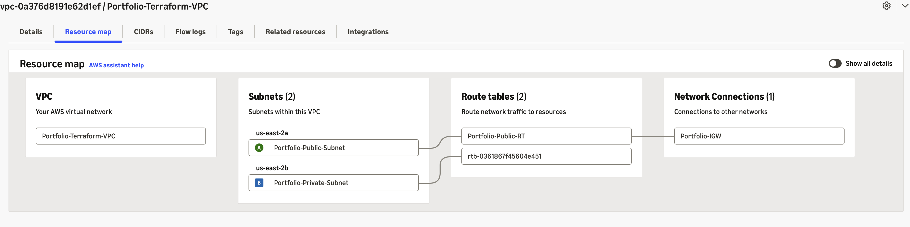
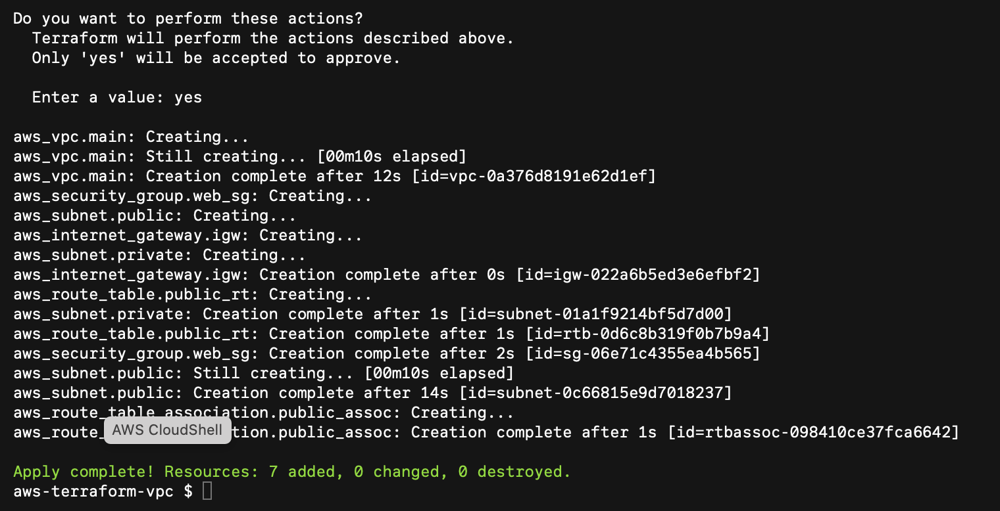
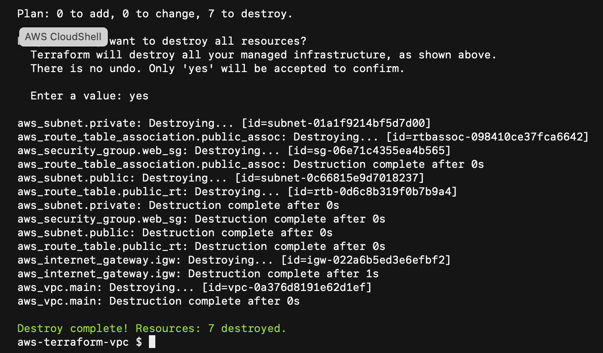

# Automated Cloud Network Setup (Terraform & AWS VPC)

An Infrastructure as Code (IaC) project using **Terraform** to automatically provision and tear down a segmented **Amazon VPC** network in `us-east-2`—eliminating manual console clicks ("ClickOps") and ensuring repeatable, error-free deployments.

## What Terraform Builds
With a single `terraform apply` command, this configuration provisions **7 AWS resources**:
- **Custom VPC (`10.0.0.0/16`):** Isolated virtual network with DNS support and hostnames enabled.
- **Public Subnet (`10.0.1.0/24` in `us-east-2a`):** Configured for internet-facing resources with auto-assigned public IPs.
- **Private Subnet (`10.0.2.0/24` in `us-east-2b`):** Isolated across a second Availability Zone with no direct route to the internet.
- **Internet Gateway (IGW):** Connects the VPC to the public internet.
- **Public Route Table & Association:** Routes outbound internet traffic (`0.0.0.0/0`) from the Public Subnet to the IGW.
- **Web Security Group (`portfolio-web-sg`):** Stateful firewall permitting inbound HTTP (80) and HTTPS (443) traffic.

## Tools & Services Used
- **Terraform (`v1.17.2`)** & **AWS CloudShell** (Zero static IAM keys required)
- **Amazon VPC** (Subnets, Route Tables, Internet Gateway, Security Groups)

## Key Design Decisions
- **Zero-Cost Architecture:** Intentionally omitted NAT Gateways to keep the lab 100% free while still demonstrating public/private subnet segmentation across two Availability Zones.
- **Full Lifecycle Verification:** Verified dry-run planning (`terraform plan`), automated provisioning (`Apply complete! Resources: 7 added`), and clean teardown (`terraform destroy`) with zero orphaned resources.

## Proof of Execution

### AWS VPC Resource Map

### Terraform Apply Output

### Terraform Destroy Output (Clean Teardown)

